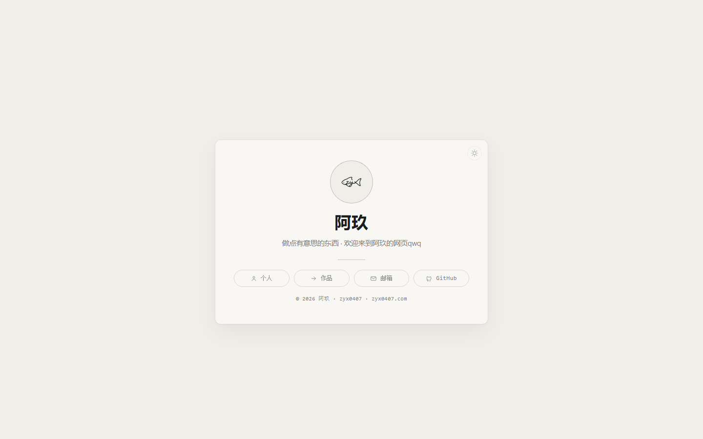

# zyx0407.com · Personal Site

[简体中文](README.md) · English

The personal homepage of 阿玖 (`zyx0407`): a name card, a few subpages, and pencil rain. **Static, no build, zero third-party dependencies** — double-click `index.html` to view it, or drop it on GitHub Pages as is.

## Pages

| Path | Content |
| --- | --- |
| `/` | Front card: a flippable 3D name card (front cover / back design), three entry pills; the tip line opens the tip QR |
| `/me/` | Sub-site home: a short profile strip plus the latest post / work / link cards |
| `/me/about.html` | About: all posts |
| `/me/work.html` | Works: the skills library, student calendar |
| `/me/links.html` | Links: request a link exchange |
| `/404.html` | Not-found page |

## What's on the page

- **Rain** — pencil strokes drawn on a canvas, layered under the content; ink colour follows the theme, never blocks clicks.
- **3D name card** — drag in any direction to rotate, release to snap back to front or back; click to flip. The back holds a crescent, a QR code, the domain, ripples and a fish drawn in one stroke.
- **Fish mark** — the only illustration on the site: black by day, white at night.

## Editing the sub-site

- Pages live in `me/`: `index.html`, `about.html`, `work.html`, `links.html`.
- A new post: copy `me/essays/who.html` to `me/essays/<name>.html`, edit title/date/body, then add a card in `me/about.html` and `me/index.html`.
- Card covers go to `me/assets/covers/`, 16:10, 1600px wide.
- Read counts use a self-hosted endpoint: `data-views="slug"` on the card, `<body data-views-post="slug">` on the post; failures fall back to `—`.

## Where the content lives

All text, links and the work list live in **one file, `site-data.js`**:

- `render.js` turns data into the page: fills whichever elements exist and skips the rest;
- `style.css` holds every metric and both palettes; `theme.js` only switches day/night (follows the system by default, remembers manual switches);
- `assets/雨.js` draws the rain, `assets/鱼-黑墨.svg` is the fish mark.

Two palettes: warm paper `#efeee9` by day, dark gallery `#0e0f11` at night. One accent colour (amber) appears only for indices, links, underlines and the current state. Three type styles: Source Han Serif (headings), Source Han Sans (body), FangSong italic (side notes).

## URL parameters

| Param | Effect |
| --- | --- |
| `?theme=day` / `?theme=night` | Force a palette (not saved) |
| `?nofade=1` | Skip the intro animation for stable frames in screenshots/automation |
| `?rain=0` / `?rain=1` / `?rain=2` / `?rain=3` | Rain off / sparse / even (default) / dense |
| `?flip=1` | Open the home name card with its back showing |

## Deployment: GitHub Pages + custom domain

1. **Settings → Pages**, set Source to the `main` branch, root folder.
2. A custom domain needs **both halves**, or you get a 404:
   - **DNS**: a `CNAME → zyx0407.github.io` record for the subdomain (use `A` / `ALIAS` for an apex domain);
   - **Repo root**: a `CNAME` file whose content is the full domain (`zyx0407.com` here). Pages uses it to recognise the Host; without it nobody claims the domain.
3. **One repo can hold one custom domain.** For a second domain (short links, redirects), create another repo.
4. It's working when `zyx0407.github.io/home/` starts returning **301** to the custom domain.
5. GitHub issues the HTTPS certificate after the domain is bound; it can take minutes to hours. A certificate mismatch during that window is normal — don't change anything.

## Notes

- No analytics scripts, no third-party resources, no user profiling.
- No open-source license is attached: text and graphic work are all rights reserved.
