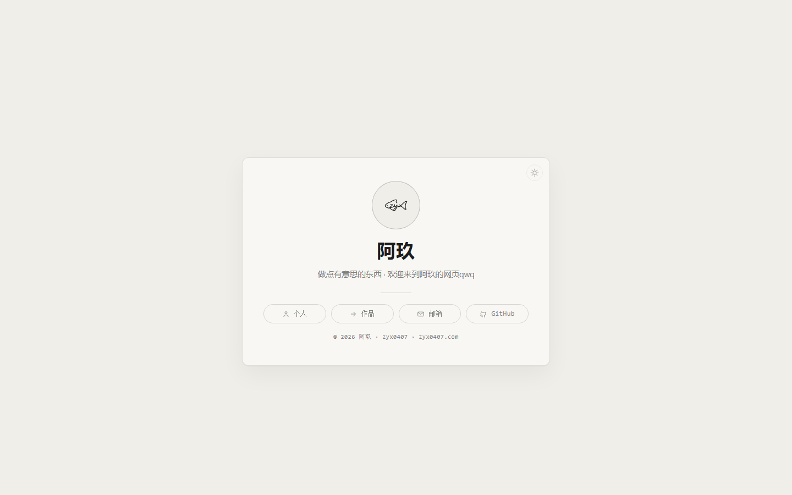

# zyx0407.com · 个人门面站

[English](README.en.md) · 简体中文

阿玖（`zyx0407`）的个人主页：一张名片卡、几个副页、下着铅笔雨。**纯静态、零构建、零第三方依赖**——双击 `index.html` 就能看，也能直接放到 GitHub Pages 上。

## 页面

| 路径 | 内容 |
| --- | --- |
| `/` | 主页：一张可翻转的 3D 名片卡（正面门面、背面卡背），三颗入口胶囊，雨点 |
| `/about/` | 关于：施工中（新版在路上） |
| `/notes/` | 互动：施工中（新版在路上） |
| `/work/` | 作品：施工中（重构中，旧单卡已撤） |

## 页面里有什么

- **雨点**：铅笔雨丝画在 canvas 上，铺在内容下面；跟随日夜换墨色，不挡点击。
- **3D 名片卡**：按住任意方向拖动旋转，松手吸附回正面或背面；点一下直接翻面；点鱼标重播写出；卡背是月牙、二维码、域名、水波和一尾连笔鱼。
- **鱼标**：全站唯一的图形，白天黑鱼、夜里白鱼。

## 内容在哪儿

所有文字、链接集中在 **`site-data.js` 一个文件里**（作品数据也留在里面，等作品页重构后再接页面）：

- `render.js` 负责「数据 → 页面」：页面上哪个元素在就填哪个，不在就跳过；
- `style.css` 是全部度量与两套配色，`theme.js` 只管日夜切换（默认跟随系统，手动切换会记住）；
- `assets/雨.js` 是雨点，`assets/鱼-黑墨.svg` 是鱼标。

配色两套 token：白天＝暖纸 `#efeee9`，深夜＝深色展厅 `#0e0f11`；一个强调色（琥珀）只用在编号、链接、下划线、当前状态四处。字型三档：思源宋（标题）· 思源黑（正文）· 仿宋斜（旁白）。

## URL 参数

| 参数 | 作用 |
| --- | --- |
| `?theme=day` / `?theme=night` | 强制某一配色，不写入本地存档 |
| `?nofade=1` | 入场动效直接给终态，供截图与自动化取稳定帧 |
| `?rain=0` / `?rain=1` / `?rain=2` / `?rain=3` | 关雨 / 疏 / 匀（默认）/ 密 |
| `?flip=1` | 主页名片卡直接翻到背面 |

## 部署：GitHub Pages + 自定义域

1. 仓库 **Settings → Pages**，Source 选 `main` 分支根目录。
2. 绑自定义域要**两半都齐**，只加 DNS 会 404：
   - **DNS**：子域名加一条 `CNAME → zyx0407.github.io`（apex 域用 `A` 或 `ALIAS` 记录）；
   - **仓库根**：一个 `CNAME` 文件，内容就是那个全域名（本仓库＝`zyx0407.com`）。Pages 靠这个文件认出 Host，缺它就没人认领这个域。
3. **一个仓库只能绑一个自定义域**；要短链、跳转层这类第二个域名，得另开一个仓库。
4. 绑成功的信号：`zyx0407.github.io/home/` 开始 **301** 到自定义域。
5. HTTPS 证书由 GitHub 在绑定之后签发，可能要等十几分钟甚至更久；这期间打开站点提示证书不匹配属正常，不用改任何东西。

## 说明

- 不加载任何统计脚本，不请求第三方资源，不做用户画像。
- 本仓库未附开源许可证：文字与图形作品保留所有权利。
